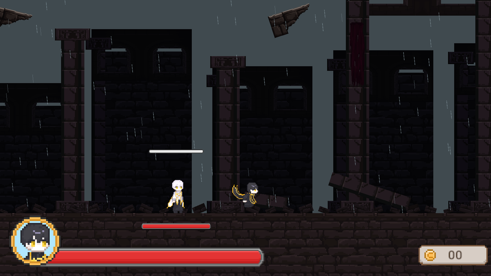

# 보스 스테이지: 비 내리는 폐허 성당

`Assets/Scenes/Gameplay/BossTest.unity`를 열고 Play한 뒤 오른쪽으로 이동한다. 시작 위치는 x=-38이며, 넓어진 진입 공간을 지나 플레이어의 몸 전체가 x=-12 입구를 통과하면 전투를 시작하고 양쪽을 봉쇄한다. 처치하면 봉쇄를 열고 탐색 카메라로 돌아온다.

첨부 레퍼런스의 높은 폐허, 열린 천장, 먹구름과 비 분위기를 기존 도트 석조 에셋으로 구성했다. 높은 기둥, 부서진 아치, 찢어진 천, 쓰러진 기둥과 작은 잔해를 씬 전체에 배치했다. 비는 Unity ParticleSystem 두 겹으로 표현한다. 장식·비에는 충돌체나 피해 판정이 없다. 바닥의 실제 충돌체와 양끝 벽도 확장했으며, 보스 위치·캐릭터 크기·공격 규칙은 유지한다. 차단막은 청회색 반투명으로 표시한다.

카메라 코드는 변경 전과 동일하게 복원했다. 탐색은 기존 `LobbyCameraFollow`, 전투는 기존 `BossArenaCamera`의 수평 추적·크기 8·최대 크기 10.5를 사용한다. 전체 전장을 한 화면에 맞추는 고정 구도를 제거하고, 탐색 경계와 복귀 제한만 넓어진 씬에 맞췄다. `StageTest`의 카메라도 원래 설정으로 복원했으며 해당 통합 테스트 맵의 폭은 유지한다. 공통 `BossEncounter` 프리팹의 전투 범위는 확장한 실제 보스 맵과 맞췄다.

| 구간 | 좌표 | 가로 폭 |
| --- | --- | --- |
| 진입 공간 | -42 ~ -12 | 30유닛 |
| 보스 전투 구역 | -12 ~ 33 | 45유닛 |
| 뒤쪽 공간 | 33 ~ 48 | 15유닛 |
| 씬 전체 | -42 ~ 48 | 90유닛 |

변경 전 씬 전체는 36유닛, 전투 구역은 30유닛이었다. 보스 밖 공간도 함께 확장했다. 저장 위치 제한은 -41~47로 넓혀 새 진입·뒤쪽 공간에서 재접속해도 기존 좁은 범위로 이동하지 않도록 했다.

- [진입 전 탐색 화면](BossStageVerification/01-approach.png)
- [4:3 전투 화면](BossStageVerification/03-arena-4x3.png)
- [처치 후 뒤쪽 공간](BossStageVerification/04-far-side.png)

## 재생성

Unity 메뉴의 `Tools > Boss > Apply ruined sanctuary stage`는 배경 프리팹과 보스 맵의 전체 배치·시작 위치·저장 경계·카메라 경계·봉쇄를 갱신한다. 반복 실행해도 배경은 한 개만 남는다. `BossProjectSetup`의 전체 보스 맵 재생성도 같은 배치와 배경 프리팹을 연결한다.

배경은 `Assets/Prefabs/Environment/BossRuinedSanctuary.prefab`, 제작 도구는 `Assets/Editor/BossStageSceneryProjectSetup.cs`다. 비의 밀도·색·길이와 배경 배치는 제작 도구에서 조절하고 다시 적용한다.

## 검증

원본 프로젝트가 다른 Unity 인스턴스에서 열려 있어 `.utmp/BossStageVerification`에 격리한 복사본에서 Unity 6000.3.5f2로 실행했다. 적용할 씬·프리팹·메타 파일과 캡처를 원본 작업 폴더에 반영했다.

- `BossCombatEditModeTests`: 24/24 통과.
- 보스 스테이지 PlayMode 2개, 기존 진입·실제 근접 공격·StageTest 구역 활성화 3개: 5/5 통과.
- 실제 렌더링으로 진입 전·16:9·4:3 전투·처치 후 뒤쪽 공간 확인.
- 실제 바닥 전체 폭과 전투 밖 진입·뒤쪽 공간의 폭, 지면 연결, 전투 전 탐색, 저장 위치 제한, 몸 전체 진입·봉쇄, 기존 배율·카메라 수평 추적, 처치 후 복구, 씬 전체 비 파티클 범위·장식 충돌체 없음 확인.

전체 보스 패턴 테스트와 장시간 수동 플레이는 이번 검증 범위에 포함하지 않았다. 결과는 [검증 요약](BossStageVerification/test-summary.json)에 기록했다.
