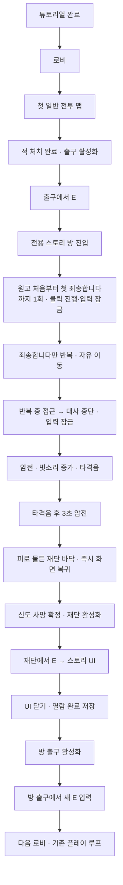

# 첫 재단 조우 — 1.1 상세기획

최초 작성: 2026-11-07 / 1.0 소스 재분석·갱신: 2026-11-11.

1.1 작업 기준은 `main`의 `781af6d83d5563a0ccbbe43e65c664dda8b65f52`(레벨 2 버그 수정)이며, 작업 브랜치는 `codex/first-altar-story-v1.1`이다. 기존 `codex/first-altar-story-spec`의 `680491cc71a05a3bc0b9efb5183160735bf2768f`에서 이 기획서와 개발명세서만 가져왔다. **첫 재단 스토리의 저장·씬·기도·사망 연출·임시 UI·출구 기능을 구현했다.** 기술 연결은 [개발명세서](FirstAltarStory_TechnicalSpec.md), 실제 검증 범위와 남은 아트·본문 항목은 [구현 결과](FirstAltarStory_ImplementationStatus.md)를 참고한다.

## 1. 의도와 확정 범위

튜토리얼 이후 첫 일반 전투를 끝낸 플레이어에게, 기존 로비 왕복 흐름에서 벗어나는 스토리 구간을 보여준다. 교리를 외우던 신도의 기도가 탄원과 자책으로 무너지고, 암전 속 타격음 뒤 피로 물든 재단 바닥이 드러난다. 이후 재단의 기록을 읽고 기존 루프로 복귀한다.

| 항목 | 내용 | 상태 |
| --- | --- | --- |
| 진입 시점 | 튜토리얼 다음 첫 일반 전투 맵을 클리어하고 출구에 상호작용할 때 | 사용자 확인 완료 |
| 발생 횟수 | 저장 프로필당 1회. 새 런마다 반복하지 않음 | 사용자 확인 완료 |
| 1.0 기존 프로필 | 업데이트 후 다음 일반 전투 맵을 클리어하고 출구에 상호작용할 때 1회 진입. 진행·재화·해금 상태 유지 | 2026-11-11 사용자 확인 완료 |
| 공간 | 재단과 신도 한 명이 있는 새로운 전용 씬 | 사용자 요청 |
| 신도 | 적 AI가 없는 연출용 NPC. 다른 씬과 같은 크기이며 제단을 바라봄 | 사용자 수정 요청 반영 |
| 기도 | 도입부는 이동 잠금·클릭 진행, 이후 사과만 자동 반복·자유 이동 | 사용자 수정 요청 반영 |
| 말풍선 글리치 | 간헐적인 글자·위치 이상 효과 | 가능하면 추가하는 선택 연출 |
| 사망 시작 | 플레이어가 신도에게 접근하면 컷씬 자동 재생 | 사용자 요청 |
| 대사 원고 | 네 교리, 비에 대한 탄원, 자책과 반복 사과 | 사용자 제공 원문, 6절에 보존 |
| 대사 재생 | 원고 처음부터 첫 단독 “죄송합니다.”까지 한 번 재생한 뒤 “죄송합니다.”만 반복 | 사용자 확인 완료 |
| 사망 표현 | 암전 → 빗소리 증가 → 둔탁한 타격음 → 타격음 후 3초 암전 → 피로 물든 재단 바닥 표시 | 최신 사용자 연출로 반영 |
| 화면 복귀 | 페이드 없이 즉시 화면 복귀 | 원문의 ‘페이즈 없이 화면 인’을 해석한 안 |
| 사망 전조 | 기존 요청의 신체 일부 글리치를 사과 구간에 배치 | 효과는 기존 요청, 배치 시점은 제안 |
| 재단 | 상호작용하면 스토리가 적힌 UI 표시 | 사용자 요청 |
| UI 디자인 | 우선 임시 레이아웃, 최종 디자인은 나중에 적용 | 사용자 요청 |
| 스토리 이후 | 스토리 UI를 닫은 뒤 전용 방 출구에서 E로 로비 복귀 | 사용자 확인 완료 |
| 진행 순서 | 신도 사망 컷씬 완료 후 재단 활성화, 스토리 열람 완료 후 출구 활성화 | 사용자 확인 완료 |

사용자 제공 대사 원문, 처음부터 첫 단독 사과까지 1회 재생 후 사과만 반복하는 구성, 타격음 뒤 3초 암전은 기준으로 유지한다. 문장별 유지 시간·거리·음량·효과 소스는 조정 가능한 초깃값이다. 사용자 요청에 없는 보상, 교리 해금, 분기 선택, 추가 전투는 이번 기능에 포함하지 않는다.

## 2. 플레이 흐름



이벤트를 완료한 프로필은 이후 일반 전투 출구에서 기존처럼 로비로 돌아간다. 상점 방문은 첫 일반 전투 클리어를 소비하지 않는다. 실제 일반 전투 맵은 현재 코드가 선택한 `CombatLevel1`~`CombatLevel6` 중 하나이며, 반드시 `CombatLevel1`이라는 뜻은 아니다.

## 3. 진입 규칙

- 튜토리얼 완료 이후, 아직 이벤트를 완료하지 않은 신규 프로필의 첫 정상 전투 출구 사용에서 진입한다.
- 적을 모두 처치한 순간에는 씬을 바꾸지 않는다. 기존처럼 출구에 접근해 E를 눌러야 한다.
- 튜토리얼 출구·상점 출구·보스 처치는 이벤트의 정상 진입 조건에 포함하지 않는다.
- 첫 전투를 클리어하기 전에 죽었다면 이벤트 기회는 유지한다. 다음 런에서 처음 전투를 클리어하고 출구를 사용하면 진입한다.
- 로비의 무작위 후보에 새 역할을 추가하지 않는다. 정해진 조건에서 출구의 목적지만 한 번 바뀐다.
- 1.0 기존 프로필도 이벤트 대상이다. 업데이트 시 즉시 씬을 바꾸지 않고, 다음 일반 전투의 완료된 출구 사용에서 진입한다. 업데이트 당시 전투를 이미 완료하고 출구만 남은 상태라면 그 출구 사용을 다음 기회로 인정한다.
- 기존 프로필의 클리어 수가 1회 이상이거나 보스 해금 조건을 달성했어도 진입한다. `combatClears == 0`을 공통 진입 조건으로 사용하지 않는다. 상점·보스·사망 결과 화면에서 시작했다면 기존 흐름을 마친 뒤 다음 일반 전투 출구까지 기다린다.
- 기존 저장 파일은 튜토리얼 완료 기록을 복원할 수 없으므로 이 이벤트에 한해 구버전 진입 자격을 부여한다. 이를 실제 튜토리얼 완료 기록으로 오인하지 않으며 튜토리얼 재플레이를 강제하지 않는다. 신규 프로필은 튜토리얼 완료 조건을 유지한다.

## 4. 전용 방과 동선

씬의 작업명은 `FirstAltarStory`로 둔다. 최종 표시 이름은 추후 정한다.

권장 배치는 **입구 → 기도하는 신도 → 재단 → 출구**다. 입장 위치에서는 기도하는 모습을 먼저 보고, 신도에게 접근한 뒤 재단에 도달하게 한다. 점프·대시로 연출을 건너뛰지 않도록 접근 판정 구역과 재단 사용 조건을 함께 설계한다.

신도는 재단 앞에서 기도하도록 배치하고, 화면 복귀 때 피로 물든 재단 바닥이 구도 안에 보이게 한다. 화면 복귀 방식은 기존 구도로 즉시 돌아오는 안이며, 별도 줌이나 카메라 이동은 추가 확정하지 않았다.

- 입장과 동시에 사망 연출을 시작하지 않는다. 플레이어가 신도를 관찰하고 다가갈 여유를 둔다.
- 적·전투 HUD·적 믿음 게이지·피해원은 배치하지 않는다.
- 신도는 플레이어를 추적하거나 공격하거나 피격 반응을 보이지 않는다.
- 도입부 원고 중에는 이동·점프·대시·공격을 잠근다. 사과 반복에 진입하면 기존 조작을 복원하며, 공격해도 NPC의 사망 시점을 바꿀 수 없다.
- 신도 크기는 튜토리얼·일반 전투의 실제 합성 배율인 약 2.1667배에 맞추고, 원본 스프라이트를 좌우 반전해 오른쪽 제단을 바라보게 한다. 발 위치와 머리 말풍선 앵커도 배율에 맞춘다.
- 입장 시 재단과 출구는 비활성 상태다. 신도 사망 컷씬 완료 후 재단을, 스토리 열람 완료 후 출구를 활성화한다.
- 재단·출구의 상호작용 안내는 기존 E 안내 규칙을 따른다.
- 남은 HP, 코인, 조각, 장착 상태는 정상 씬 이동 규칙을 유지한다. 이 방 입장 자체로 회복·차감·보상을 주지 않는다.

## 5. 연출 순서와 시간 기준

대사는 6절의 확정된 1회 재생 → 사과 반복 규칙을 따른다. 아래 순서에서 **3초는 타격음 뒤의 암전 유지 시간**이며, 빗소리가 커지는 앞 구간과 합쳐서 3초로 줄이지 않는다.

| 구간 | 표현과 동작 | 시간·확정 범위 |
| --- | --- | --- |
| 입장·1회 기도 | 원고 처음부터 첫 단독 “죄송합니다.”까지 타이핑·클릭 진행, 플레이어 입력 잠금 | 타이핑 중 클릭은 현재 문장 완성, 완성 후 새 클릭은 다음 문장. 자동 넘김 없음 |
| 반복 사과 | 이후 “죄송합니다.”만 계속 자동 반복, 플레이어 자유 이동. 국소 글리치 전조를 배치할 수 있음 | 반복 횟수 제한 없음. 간격·표시 속도는 조정 |
| 접근 | 사과 반복 상태에서 접근하면 반복을 중단하고 컷씬 입력 잠금, 암전 연출 시작 | 신도와 약 2.5유닛. 첫 원고를 다시 읽거나 남은 컷씬 대사를 재생하지 않음 |
| 암전 | 말풍선·HUD·월드를 완전히 가리고 빗소리를 점점 키움 | 빗소리 상승 시간·곡선은 미정 |
| 타격음 | 완전 암전 상태에서 둔탁한 타격음을 한 번 재생, 암전 아래에서 사망·혈흔 결과 준비 | 1회 재생 |
| 타격음 뒤 정적 | 화면은 완전히 검은 상태로 유지 | 타격음 시작 시점부터 3.0초 |
| 화면 복귀 | 피로 물든 재단 바닥과 사망 결과가 이미 준비된 화면을 즉시 표시 | ‘페이드 없이’로 해석한 안, 검정 오버레이를 한 프레임에 제거 |
| 종료 | 사망 상태 저장이 성공하고 컷씬이 끝나면 재단 활성화 | 출구는 스토리 열람 전까지 비활성 |

1회 기도는 튜토리얼·엔딩 컷씬과 같은 클릭 진행 규칙을 쓴다. 원고가 끝날 때까지 플레이어 조작을 잠그고, 마지막 클릭 해제 후 사과 자동 반복과 자유 이동으로 전환한다. 접근 사망 컷씬은 클릭 없이 자동 진행하며 별도 공격으로 신도를 죽이지 않는다.

조기 접근 처리안: 첫 단독 사과까지의 원고를 듣기 전에 접근해도 대사를 잘라서 암전하지 않는다. 1회 재생을 마치고 사과 반복을 최소 한 번 표시한 뒤에도 플레이어가 접근 범위 안에 있으면 사망 컷씬을 시작한다. 그 전에 범위를 벗어났다면 반복을 유지한다. 이 대기 처리는 원고 1회 재생을 보장하기 위한 구현 제안이다.

최신 연출은 사망 순간을 암전으로 가리고 혈흔 결과를 드러내는 방식이다. 이전의 약 2.6초짜리 노출 사망·혈액 분출 시간표는 이 순서로 대체한다. 기존 요청의 신체 일부 글리치는 암전 직전 전조로 배치하는 안으로 남긴다. 신체 절단·물리 파편·래그돌은 현재 요구 범위에 포함하지 않는다.

원문의 ‘페이즈 없이 화면 인’은 ‘페이드 없이 즉시 화면 복귀’로 해석했다. 원문 표기는 6절에 그대로 보존하며, 화면 전환 방식은 이 해석에 따른다.

## 6. 사용자 제공 원고와 대사 재생 규칙

아래 원고는 문장·문장부호·줄 구분·반복 횟수를 그대로 보존한다. 괄호 안 내용은 표시 대사가 아닌 연출 지시다.

```text
하나. 구름은 모든 것을 내려다본다
둘. 비는 축복이다
셋. 맑은 하늘은 없을 것이다.
넷. 구름을 믿어라.

...

비는, 구름은, 비는, 구름은...

...

비가 너무 많이 와요.

모두가 잠겨버렸습니다.

비를 그쳐주시면...

아...

제가 무슨 말을.

죄송합니다.

죄송합니다.죄송합니다.죄송합니다.죄송합니다.죄송합니다.죄송합니다.

(암전, 빗소리가 점점 커지다가 둔탁한 타격음, 3초 암전)

(피로 물든 재단 바닥, 페이즈 없이 화면 인)
```

사용자 확인에 따라, **“하나. 구름은 모든 것을 내려다본다”부터 첫 단독 “죄송합니다.”까지 한 번 재생하고 이후 “죄송합니다.”만 반복**한다. 네 교리만 반복하거나, 접근 후에 탄원·자책 대사를 따로 시작하는 방식은 사용하지 않는다.

| 묶음 | 재생 규칙 | 상태 |
| --- | --- | --- |
| 원고 처음부터 첫 단독 “죄송합니다.”까지 | 순서대로 한 번만 타이핑·클릭 진행, 플레이어 입력 잠금 | 사용자 수정 요청 반영 |
| 이후 “죄송합니다.” | 해당 문장만 계속 자동 반복, 접근으로 사망 컷씬이 시작되면 중단 | 반복 구성은 사용자 확인 완료, 접근 연결은 기존 조건을 적용한 해석 |
| 문장 사이 독립된 `...` 두 곳 | `...`를 말풍선에 표시하고 클릭으로 진행 | 도입부 전체의 클릭 규칙과 통일 |
| 마지막 괄호 두 줄 | 접근 후 암전·빗소리·타격음·3초 대기·혈흔 화면 복귀 | 기존 사망 진입 조건과 최신 연출을 연결 |

1회 기도는 입력을 잠그고 클릭을 기다리며, 사과 반복은 자유 이동 상태에서 자동 진행한다. 말풍선은 신도 머리와 카메라를 따라가고 화면 가장자리에서도 읽을 수 있게 한다. 마지막 클릭을 월드 공격으로 넘기지 않으며, 접근 사망 컷씬 시작 시 반복 타이머와 말풍선을 정지·숨긴다. 접근 범위를 드나들어도 도입부를 다시 시작하지 않는다.

위 원고의 마지막 연속 사과 여섯 번은 제출된 원문으로 보존한다. 실제 재생은 최신 확인 내용에 따라 “죄송합니다.”를 반복하는 루프로 구성하며, 여섯 번 뒤 자동 종료하거나 교리로 되돌아가지 않는다.

말풍선 글리치는 대부분의 문장을 읽을 수 있는 강도로 제안한다. 작은 위치 어긋남·짧은 잔상·일부 글자의 순간 치환은 표시 효과로만 처리하고 원문 데이터나 반복 상태를 변경하지 않는다. 암전이 시작되면 모든 말풍선을 숨긴다. 최종 재단 스토리 UI 본문에는 이 효과를 자동 적용하지 않는다.

빗소리 상승과 둔탁한 타격음은 이번 연출에 포함한다. 음량·상승 시간·타격음 소스·복귀 후 빗소리 레벨은 조정 항목이다. 발화 음성·중얼거리는 소리·노이즈는 별도 소스가 정해지면 추가한다. 필드 BGM은 빗소리와 타격음이 드러나도록 이 방에서 줄이거나 끄는 안으로 둔다. 재단 스토리 UI의 제목·본문은 신도 대사 원고와 별개로 아직 미정이다.

## 7. 재단과 스토리 UI

신도 사망 컷씬이 끝나고 사망 상태 저장이 성공하면 재단을 활성화한다. 활성화된 재단에서 E를 누르면 스토리 UI를 연다. 기존 로비 재단의 교리 조합 화면과 용도가 다르므로 전용 스토리 상호작용을 사용한다.

| 진행 상태 | 재단 | 방 출구 |
| --- | --- | --- |
| 방 입장·기도 중·대사/암전/타격음/화면 복귀가 진행 중 | 비활성 | 비활성 |
| 사망 상태 저장 및 컷씬 완료 후 | 활성 | 비활성 |
| 스토리 UI 최초 열람 중 | 모달 입력 잠금 | 비활성 |
| UI 닫기·열람 완료 저장 후 | 활성, 재열람 가능 | 활성, E로 로비 복귀 |
| 재열람 UI가 열린 동안 | 모달 입력 잠금 | 열람 완료 상태 유지, 모달 입력 잠금 |
| 로비 전환 중 | 입력 잠금 | 입력 잠금 |

비활성 대상에는 E 안내를 표시하지 않고 상호작용도 받지 않는다. 점프·대시로 먼저 재단이나 출구에 도달해도 위 순서를 유지한다.

| 요소 | 첫 버전 |
| --- | --- |
| 제목 | 데이터에서 교체 가능한 제목 |
| 본문 | 한글 줄바꿈과 긴 글 스크롤을 지원하는 텍스트 |
| 종료 | 닫기 버튼, E, ESC |
| 배경 | 임시 패널과 텍스트. 이후 아트 교체 가능 |
| 입력 | 열린 동안 월드 이동·공격·상호작용 차단 |
| 재열람 | 방을 나가기 전에는 다시 열 수 있음 |
| 원문 | 제목·본문 모두 미정. 확정 원문을 데이터에 입력 |

열람 완료는 **본문이 표시된 뒤 닫기 동작을 수락하고, 열람 상태 저장에 성공한 시점**으로 기록한다. 저장 성공 후 UI를 닫고 출구를 활성화한다. 스크롤 끝까지 내리는 행동이나 실제 독서 시간을 강제하지 않는다. UI를 연 E 입력이 같은 프레임에 창을 닫지 않게 하고, 닫기 클릭이 공격으로 이어지지 않게 한다.

이벤트 완료는 열람 완료와 구분한다. UI를 닫은 뒤 플레이어가 방 출구로 이동해 **새 E 입력으로 로비 복귀를 확정할 때 이벤트가 완료**된다. UI 닫기는 씬 이동을 실행하지 않는다. 창을 닫는 데 사용한 E를 계속 누르고 있어도 바로 퇴장하지 않는다.

## 8. 저장과 재개

| 마지막 저장 단계 | 다시 시작했을 때 |
| --- | --- |
| 전투 완료, 출구 사용 전 | 해당 전투 맵과 완료된 출구 상태 복원 |
| 스토리 방 입장 확정 | 같은 방에서 살아 있는 신도와 기도 순환 복원. 재단·출구 비활성 |
| 1회 기도·사과 반복·암전·타격음 뒤 대기·화면 복귀 중, 사망 저장 전 | 방 진입의 1회 기도부터 재개. 재단·출구 비활성, 사과 반복 상태에서 접근하면 사망 컷씬 시작 |
| 신도 사망 저장 후 | 신도 사망·피로 물든 재단 바닥·재단 활성·출구 비활성 복원. 컷씬 대사·암전·타격음은 재생하지 않음 |
| 스토리 열람 저장 후, 방 퇴장 전 | 신도 사망·재단 활성·출구 활성 복원. UI는 닫힌 상태이며 재열람 가능 |
| 방 퇴장·이벤트 완료 저장 후 | 다음 로비에서 재개. 이후 런에서도 이 이벤트는 다시 나오지 않음 |

원래 일반 전투의 클리어는 방 입장 거래에서 **정확히 1회** 반영하고, 방을 나갈 때 다시 올리지 않는 안으로 설계한다. 로비 방문 수 증가와 다음 후보 생성은 실제 로비 복귀 시점에 한 번 수행한다.

저장이 실패하면 다음 씬으로 이동하거나 다음 진행 단계를 확정하지 않는다. 사망 연출의 마지막 저장만 실패한 경우에는 3초 암전 뒤 드러난 혈흔 화면에서 입력 잠금을 유지하고 저장만 재시도한다. 같은 실행에서 대사·빗소리 상승·타격음·3초 암전을 반복하지 않는다. 저장 실패를 이유로 최초 암전 시간을 무기한 늘리지 않는다.

## 9. 첫 구현 범위와 후속 결정

첫 구현에는 전용 씬, 최초 출구 분기, AI 없는 신도, 원고의 1회 자동 기도와 사과 반복, 암전·빗소리 상승·둔탁한 타격음·타격음 후 3초 암전·혈흔 화면 복귀, 임시 스토리 UI, 진행 저장·복원, 기존 루프 복귀를 포함한다. 기존 요청의 국소 신체 글리치는 사망 전조로 배치하는 안이며, 말풍선 글리치는 기본 흐름 뒤 붙일 수 있는 선택 연출로 둔다.

개발 전에 추가로 결정할 항목은 다음과 같다.

| 결정 항목 | 현재 제안 |
| --- | --- |
| 화면 복귀 표현 | ‘페이즈 없이’를 ‘페이드 없이’로 해석한 즉시 복귀 안 |
| 재단 스토리 UI 원문 | 신도 원고와 별개. 제목·본문은 미정 |
| 시체·혈흔의 형태 | 재단 바닥이 피로 물든 결과는 반영. 사망 스프라이트·혈흔 아트·최종 구도는 조정 |

기존 프로필 적용 정책은 확정되었다. 1.0 파일을 읽을 때 진행과 재화를 보존하면서 이벤트 미시작·진입 가능 상태를 추가한다. 이벤트가 완료된 1.1 저장을 다시 읽을 때는 이 초기화를 반복하지 않는다.

## 10. 완료 판정

- 신규 프로필에서 튜토리얼 뒤 첫 일반 전투 출구를 사용하면 로비 대신 전용 방에 들어간다.
- 1.0 기존 프로필도 업데이트 후 다음 일반 전투 출구에서 한 번 진입한다. 기존 클리어 수·보스 해금·재화·교리·HP·통계·상자 영수증을 마이그레이션에서 초기화하지 않는다.
- 상점을 먼저 방문해도 첫 전투 이벤트가 유지되며, 첫 전투 전 사망으로 기회를 잃지 않는다.
- 신도는 다른 씬과 같은 크기로 제단을 바라보며, 적 AI·공격·피해 판정·처치 보상 없이 기도한다.
- 1회 기도 중 이동·점프·대시·공격이 잠기며, 타이핑 중 클릭은 문장 완성, 그 다음 클릭은 다음 대사 진행으로 동작한다.
- 첫 단독 사과의 마지막 클릭을 해제한 뒤 사과 자동 반복과 자유 이동으로 전환하며, 접근하면 사망 연출이 한 번 시작된다.
- 원고 처음부터 첫 단독 “죄송합니다.”까지 한 번만 재생하고 이후 사과만 계속 반복한다. 여섯 번을 넘어 기다려도 교리로 돌아가거나 자동으로 사망하지 않는다.
- 반복 중 접근하면 말풍선이 멈추고 완전 암전에서 빗소리가 커지며 둔탁한 타격음이 한 번 난다. 타격음 후 3.0초 동안 검정 화면을 유지한다.
- 화면 복귀 첫 프레임에 피로 물든 재단 바닥이 이미 보인다. 즉시 복귀 해석안에서는 페이드·의도하지 않은 중간 프레임 노출이 없다.
- 재단은 사망 상태 저장·컷씬 완료 전까지 비활성이며, 이후 E로 스토리 UI를 열 수 있다. 교리 조합 UI는 함께 열리지 않는다.
- 출구는 스토리 열람 완료 저장·UI 닫기 전까지 비활성이며, 이후 방 출구에서 새 E 입력으로 로비에 복귀한다.
- UI를 닫거나 재열람하는 것만으로 로비로 이동하지 않으며, 닫기에 사용한 E를 유지해도 퇴장하지 않는다.
- 진행 단계별 재접속과 저장 실패 후 재시도에서 클리어 수·보상·연출 확정이 중복되지 않는다.
- 이벤트 완료 후 기존 로비 후보와 플레이 루프로 복귀하고, 프로필의 이후 런에서는 재발생하지 않는다.

재단·출구 활성화 순서와 방 출구 E 복귀는 확정 검수 기준이다. 구현 결과와 실제 테스트 통과 여부는 구현 후 별도 기록한다.

## 11. 1.0에서 이어받는 범위와 출시 준비

- 1.0 게임 소스·씬·밸런스의 기준은 위 `main` 커밋이다. 예전 기획 브랜치의 게임 소스나 삭제된 문서·도구 전체를 병합하지 않는다.
- 현재 코인 보상·대시 무적·몬스터 방향 전환·개발자 도구·교리 UI 수정은 1.0 동작을 기준으로 유지한다. 스토리 저장과 라우팅에 필요한 연결만 확장한다.
- 구현에서는 전용 씬과 저장 스키마 v5를 추가했다. `ProjectSettings`의 `bundleVersion`은 `1.0`을 유지하며, 실제 1.1 배포 빌드를 만들 때 변경한다.
- 1.1 출시 전에는 기존 저장 업그레이드, 신규 프로필 경로, 방 안 재개, 완료 후 재발생 방지, 기존 보스·상점·사망 루프를 우선 검증한다. 개발 중에는 변경 범위에 필요한 검증만 수행하고 전체 EditMode·PlayMode 반복 실행은 기본 절차로 두지 않는다.
- 재단 스토리 UI 제목·본문, 혈흔·타격음 소스와 화면 복귀 표현의 최종 확인은 구현·연출 완료 전 남은 항목이다. 신도 기도 원고를 재단 본문으로 임의 확정하지 않는다.
